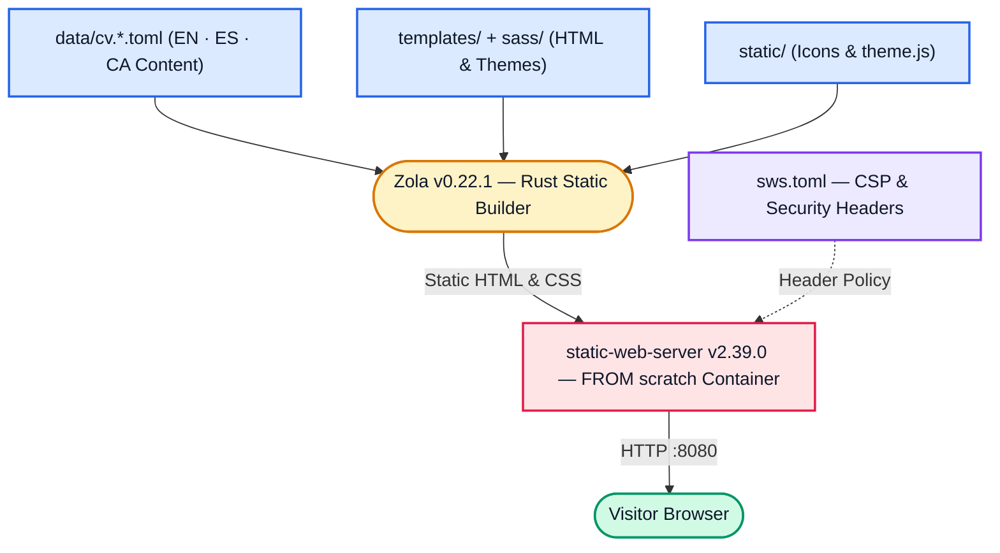

# David Belmonte — Personal Website & CV

Static CV and cybersecurity portfolio built with an end-to-end Rust toolchain (**Zola** + **`static-web-server`**) and packaged as a hardened `FROM scratch` container.

## Architecture Diagram



## Dependencies

### Host Requirements
- **Docker** and **Docker Compose** (v2)

### Container Base Images (Pinned in `Dockerfile`)
- `ghcr.io/getzola/zola:v0.22.1` — build stage only (not included in the final image)
- `joseluisq/static-web-server:2.39.0` — final `FROM scratch` runtime image

## Project Structure

- `config.toml` — Site metadata and external profile links (GitHub, LinkedIn)
- `data/cv.en.toml`, `data/cv.es.toml`, `data/cv.ca.toml` — Structured CV data in English, Spanish, and Catalan
- `content/` — Localized page definitions (`_index*.md`, `cv*.md`)
- `templates/` — Tera HTML templates (`base.html`, `index.html`, `cv.html`, `404.html`)
- `sass/main.scss` — Dark/Light themes and layout styles
- `static/` — Static assets (`favicon.svg`, `robots.txt`, `theme.js`)
- `sws.toml` — `static-web-server` configuration and HTTP security headers

## Run in Docker

```bash
docker compose up --build -d
```

Open `http://localhost:8080` (override the host port with `PORT=8081 docker compose up -d`).

## Updating Content

- Edit [data/cv.en.toml](data/cv.en.toml), [data/cv.es.toml](data/cv.es.toml), and [data/cv.ca.toml](data/cv.ca.toml) to update experience, certifications, education, skills, or languages.
- Edit [config.toml](config.toml) to update site metadata or social links.
- Rebuild and restart with:

```bash
docker compose up --build -d
```
